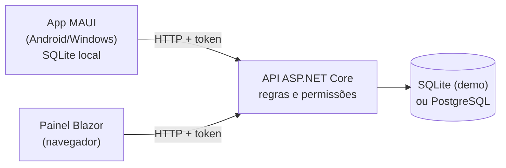

# Panis360

Sistema de gestão comercial para distribuidora B2B de insumos de panificação (fermento, misturas e outros perecíveis). Cobre o ciclo **pedido → corte → venda → baixa de estoque por lote → contas a receber**, com aplicativo de vendas que funciona sem internet.

[](https://github.com/vanderleifonseca/Panis360/actions/workflows/build.yml)

> **Situação:** base funcional para desenvolvimento e homologação. Não emite nota fiscal, boleto ou PIX e ainda não está preparada para produção. Veja [Roadmap e limitações](docs/08-roadmap.md).

## O que o sistema faz

| Módulo | Funcionalidades |
| --- | --- |
| **Clientes e roteiro** | Cadastro com CPF/CNPJ, carteira por vendedor, sequência de visitas, registro de visitas, bloqueio de compras |
| **Produtos** | Catálogo com unidade (UN, KG, L), preço e estoque válido disponível |
| **Pedidos e cortes** | Pedido com identificador único (reenvio não duplica), corte com motivo preservando a quantidade solicitada, cancelamento |
| **Venda** | Confirmação em transação única: baixa de estoque por validade (FEFO) e geração das parcelas |
| **Estoque por lote** | Entrada de lotes com validade, ajuste com motivo, histórico de movimentações com usuário |
| **Contas a receber** | Parcelas por condição de pagamento (à vista, 7/14, 7/14/21 ou personalizada), recebimento parcial |
| **Administração** | Usuários e perfis, condições de pagamento, indicadores e trilha de auditoria |
| **App de vendas** | Android/Windows: carteira e catálogo em cache, pedidos em fila local offline, sincronização manual |

## Arquitetura em uma imagem



Somente a API acessa o banco central. Detalhes em [Arquitetura](docs/04-arquitetura.md).

**Tecnologias:** C# / .NET 10 · ASP.NET Core (minimal API) · Blazor Interactive Server · .NET MAUI 10 · Entity Framework Core 10 · SQLite · PostgreSQL 17.

## Início rápido

Pré-requisito: [SDK .NET 10](https://dotnet.microsoft.com/download). Para o aplicativo, também os workloads MAUI e o SDK Android.

```powershell
git clone https://github.com/vanderleifonseca/Panis360.git
cd Panis360
.\scripts\Preparar.ps1          # define e-mail e senha do administrador e compila
```

Em dois terminais:

```powershell
dotnet run --project src/Panis360.Api --launch-profile http   # API em http://localhost:5207
dotnet run --project src/Panis360.Web --launch-profile http   # Painel em http://localhost:5116
```

Abra `http://localhost:5116` e entre com o administrador criado. A API precisa estar rodando para o painel funcionar.

Passo a passo completo, aplicativo Android, Wi-Fi, PostgreSQL e solução de problemas: **[Instalação e execução](docs/02-instalacao.md)**.

## Testes

```powershell
dotnet run --project tests/Panis360.Tests
```

Executa 15 verificações de regras e operações em um banco SQLite temporário. O GitHub Actions compila a solução e roda os testes a cada push. Veja [Testes e validação](docs/07-testes-validacao.md).

## Estrutura do repositório

```text
src/
  Panis360.Domain/          Entidades persistidas
  Panis360.Contracts/       DTOs de entrada e saída (compartilhados com Web e App)
  Panis360.Application/     Regras: dinheiro, quantidades, parcelamento
  Panis360.Infrastructure/  DbContext e operações transacionais (pedido, corte, venda, recebimento)
  Panis360.Api/             Endpoints, autenticação e autorização
  Panis360.Web/             Painel administrativo Blazor
  Panis360.App/             Aplicativo de vendas .NET MAUI (fora da solução principal)
tests/Panis360.Tests/       Verificações automatizadas
database/                   Scripts SQL do PostgreSQL
scripts/                    Preparação, PostgreSQL e acesso do celular via USB
docs/                       Documentação
```

## Documentação

| Documento | Conteúdo |
| --- | --- |
| [01 — Visão geral](docs/01-visao-geral.md) | Contexto do negócio, perfis de acesso e funcionalidades |
| [02 — Instalação e execução](docs/02-instalacao.md) | Ambiente, API, painel, Android, PostgreSQL, problemas comuns |
| [03 — Regras de negócio](docs/03-regras-negocio.md) | Ciclo do pedido, corte, venda FEFO, parcelas, recebimentos |
| [04 — Arquitetura](docs/04-arquitetura.md) | Projetos, segurança, persistência, aplicativo offline |
| [05 — Modelo de dados](docs/05-modelo-dados.md) | Entidades, relacionamentos e restrições |
| [06 — API](docs/06-api.md) | Endpoints, permissões, erros e exemplos |
| [07 — Testes e validação](docs/07-testes-validacao.md) | Testes automatizados, CI e o que falta validar |
| [08 — Roadmap e limitações](docs/08-roadmap.md) | O que não está implementado e decisões pendentes |
| [ADR 001](docs/adr/001-arquitetura.md) | Decisão de arquitetura: monólito modular com app offline |

Para contribuir, leia [CONTRIBUTING.md](CONTRIBUTING.md).

## Segurança

Não envie ao repositório senhas, strings de conexão, bancos de dados (`*.db`, `*.db.bak*`), arquivos `.env` ou dados reais de clientes. O `.gitignore` já bloqueia os casos comuns. Segredos locais ficam em `dotnet user-secrets`.
