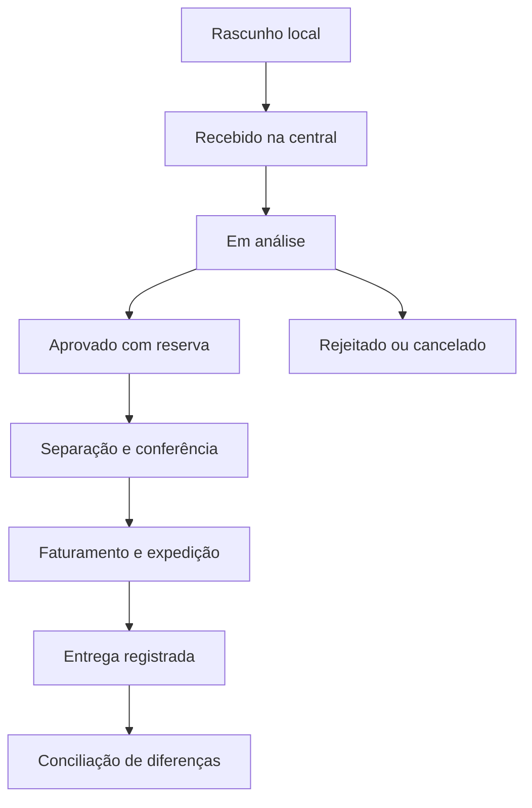

# 03 — Regras e fluxos operacionais

## Ciclo do pedido

Estados de sincronização, pedido, documento fiscal, entrega e título são independentes. Pedido entregue não significa pago. Falha fiscal não significa perda da reserva. Cancelamento após faturamento exige fluxo de compensação e validação fiscal, nunca exclusão silenciosa.

## Regras identificadas

- **RN01:** uma praça não pode ter vendedores exclusivos concorrentes no mesmo período. A definição de praça e eventuais substituições depende de D04.
- **RN02:** sequência do roteiro começa em incrementos de 10; reorganizar posições não altera o histórico das visitas.
- **RN03:** coleta não movimenta nem reserva estoque. Exibir aviso de confirmação posterior.
- **RN04:** pedido recebido mantém fotografia dos preços, condições, carteira e versão do catálogo. Divergência comercial retorna para análise, sem alteração silenciosa do valor.
- **RN05:** aprovação reserva saldo válido; cancelamento antes da saída libera reserva. Expedição converte reserva em saída uma única vez.
- **RN06:** preferir lote com vencimento mais próximo (FEFO). Validar novamente validade e bloqueio na expedição.
- **RN07:** entrega não pode exceder a quantidade expedida. Mercadoria devolvida entra em conferência/quarentena; retorno físico não libera venda automaticamente.
- **RN08:** diferença entre faturado e entregue gera ajuste fiscal/financeiro rastreável. Cobrança líquida deve corresponder às mercadorias aceitas e demais valores autorizados.
- **RN09:** condição define percentuais/prazos; forma define instrumento. As regras aplicadas são copiadas para a venda.
- **RN10:** multas, juros e descontos não possuem percentual padrão aprovado. Os exemplos de 5%, 2% ao dia e 1% ao dia são referências fornecidas, pendentes de confirmação e validação antes de uso.
- **RN11:** registros com movimentação não são apagados; são inativados ou compensados por eventos.

## Corte proporcional proposto

Agrupar por produto, depósito e janela. Saldo alocável = estoque físico elegível − reservas ativas − bloqueios não refletidos no saldo elegível. Não descontar duas vezes lotes já excluídos.

Para unidade comercial inteira: calcular cota ideal proporcional; arredondar para baixo em múltiplos válidos; distribuir as sobras pelas maiores partes fracionárias. Empates: ordem de recebimento na central e identificador do pedido. Saldo insuficiente para um múltiplo permanece sem alocação. Ajuste manual exige motivo e respeita saldo e limite solicitado.

Exemplo: pedidos A=50, B=30, C=20; saldo=70; múltiplo=1. Aprovação: 35, 21 e 14. Soma=70; cortes=15, 9 e 6. Em produtos com embalagens diferentes, normalizar para a unidade-base antes do cálculo; conversões são propostas a confirmar em D08.

Uma nova rodada deve considerar reservas existentes. Revisão da rodada libera/substitui suas reservas na mesma transação; repetir a confirmação não reserva novamente. Prioridade por histórico financeiro fica manual no MVP e exige critério visível, sujeito a D05.

## Financeiro e entrega parcial

Exemplo sem frete: 10 solicitadas, 8 faturadas a R$ 100, 6 aceitas. Documento original: R$ 800. Registrar ocorrência de R$ 200 e encaminhar tratamento fiscal apropriado. A cobrança líquida final deverá ser R$ 600; se já houver títulos, lançar ajuste vinculado, sem apagar o original. Enquanto a divergência estiver aberta, impedir a cobrança automática do valor contestado.

Parcelamento proposto: percentuais somam 100%; cálculo decimal; diferença de centavos vai para a última parcela. R$ 100 em três parcelas iguais: R$ 33,33 + R$ 33,33 + R$ 33,34. Marco do prazo, frete, calendário e renegociação dependem de D06/D07/D13.

## Janelas

12h e 19h são horários informados. Proposta: central processa pedidos recebidos até o fechamento; pedidos posteriores seguem para a próxima janela. Usar instante do servidor para o corte temporal. Pedido gravado offline às 11h e recebido às 13h não volta automaticamente para a janela já fechada.
