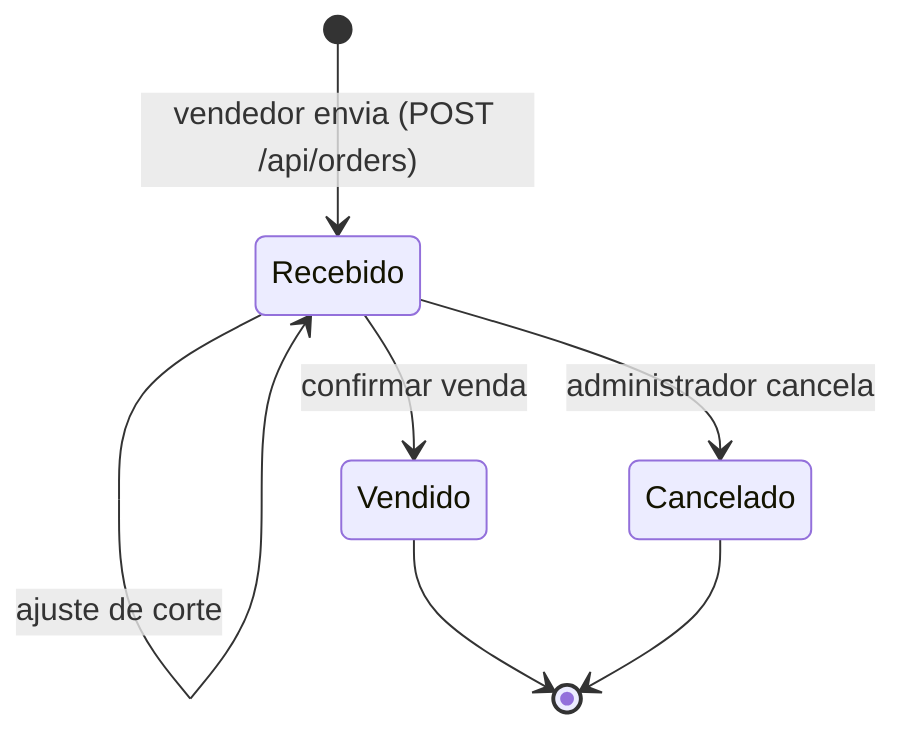

# 03 — Regras de negócio

Este documento descreve o comportamento **implementado**. A referência no código está entre parênteses.

## Ciclo do pedido

| Status | Significado |
| --- | --- |
| **Recebido** | Pedido gravado na central. O estoque ainda **não** está reservado. O atendimento pode ser ajustado |
| **Vendido** | Venda confirmada: estoque baixado e parcelas geradas. **Imutável** nesta versão |
| **Cancelado** | Cancelado pelo administrador antes da venda |

Não existem estorno de venda, devolução nem reserva antecipada.

## Pedido (`Operations.CreateOrder`)

- O cliente precisa existir, pertencer à carteira do vendedor (o administrador pode usar qualquer cliente) e não estar bloqueado.
- De 1 a 200 itens, sem repetir produto. Os produtos precisam estar ativos.
- **Preço, vendedor e nome do produto são definidos pelo servidor**, nunca pelo que o cliente envia. O preço fica copiado no item.
- O pedido não é limitado pelo estoque: pedir 100 com saldo de 70 é permitido.
- A condição de pagamento precisa existir. A forma precisa ser Boleto, PIX, Dinheiro ou Cartão.

### Idempotência

Cada pedido traz um `ClientRequestId` (GUID gerado no app ou no painel) e o servidor guarda o hash SHA-256 do conteúdo.

| Situação | Resultado |
| --- | --- |
| Mesmo identificador, mesmo conteúdo, mesmo vendedor | Devolve o pedido já gravado, sem duplicar |
| Mesmo identificador com conteúdo diferente ou de outro vendedor | Recusado: "Identificador já utilizado por outro pedido" |

Por isso, o app pode reenviar com segurança um pedido cujo envio caiu por timeout.

## Corte (`Operations.Cut`)

- Só em pedido **Recebido**, com motivo obrigatório.
- Precisa informar **todos** os itens, sem repetição.
- Quantidade atendida entre 0 e a solicitada. A quantidade solicitada **nunca muda**.
- Pode ser refeito quantas vezes for necessário antes da venda.

## Confirmação da venda (`Operations.ConfirmSale`)

Executa em **uma única transação Serializable**: ou tudo acontece, ou nada.

1. Se o pedido já está Vendido, devolve a venda existente (confirmar de novo não duplica).
2. Recusa se o cliente estiver bloqueado ou se o total atendido for zero.
3. Calcula o total: soma de `atendido × preço` por item, arredondada por linha.
4. Para cada item atendido, baixa o estoque por **FEFO** (primeiro o que vence antes):
   - considera só lotes com validade **igual ou posterior a hoje**;
   - ordena por validade (empate pelo identificador do lote);
   - se o saldo válido não cobre **toda** a quantidade atendida, a venda inteira falha com "Estoque insuficiente para X. Ajuste o corte.";
   - cada baixa gera uma movimentação "Venda" com o usuário.
5. Gera as parcelas conforme a condição de pagamento.
6. Marca o pedido como Vendido e registra a auditoria.

O estoque **não** é reservado no pedido: a disponibilidade só é garantida no momento da confirmação.

## Parcelamento (`Rules.Split`)

- De 1 a 24 parcelas, prazo de 0 a 3.650 dias, percentuais positivos que somam **exatamente 100%**.
- Cada parcela é `total × percentual`, arredondada a 2 casas; a **última** recebe a diferença dos centavos.
- Vencimento = data da venda + prazo, em **dias corridos**, sem ajuste de fim de semana ou feriado.
- A data da venda usa o fuso **America/Sao_Paulo**.
- Juros, multa e desconto **não** são calculados.

| Exemplo | Resultado |
| --- | --- |
| R$ 235,00 em 7/14 (50% + 50%) | R$ 117,50 + R$ 117,50 |
| R$ 100,00 em 7/14/21 (33,33% + 33,33% + 33,34%) | R$ 33,33 + R$ 33,33 + R$ 33,34 |

## Recebimento (`Operations.Receive`)

- Transação Serializable. Só os perfis Financeiro e Administrador.
- Valor maior que zero, com até 2 casas e no máximo igual ao saldo da parcela. Recebimento parcial é permitido.
- Cada recebimento tem um `RequestId` único: repetir a mesma requisição não baixa duas vezes. O mesmo `RequestId` com outra parcela ou outro valor é recusado.
- Não há estorno de recebimento.

## Estoque por lote

| Operação | Regras |
| --- | --- |
| **Entrada** (`POST /api/lots`) | Código obrigatório e único por produto; validade igual ou posterior a hoje; gera a movimentação "Entrada inicial" |
| **Ajuste** (`PUT /api/lots/{id}`) | Motivo obrigatório (até 200 caracteres); novo saldo de 0 a 1.000.000; a diferença vira a movimentação "Ajuste: motivo"; controle de concorrência pela revisão do lote |
| **Histórico** (`GET /api/lots/{id}/movements`) | Movimentações da mais recente para a mais antiga, com saldo após cada uma e o usuário |

O "estoque válido" do catálogo é a soma dos lotes não vencidos.

## Quantidades e valores

| Regra | Valor |
| --- | --- |
| Unidades de produto | UN, KG, L |
| Quantidade | Maior que 0, até 1.000.000, até 3 casas decimais |
| Produto em UN | Exige quantidade inteira (pedido, corte e lote) |
| Preço | De R$ 0,01 a R$ 1.000.000, até 2 casas |
| Arredondamento de dinheiro | 2 casas, meio para longe do zero (`MidpointRounding.AwayFromZero`) |
| Precisão no banco | `decimal(18,3)` em todos os campos decimais |

## Clientes

- Documento normalizado para apenas dígitos: 11 (CPF) ou 14 (CNPJ), único no sistema. Os dígitos verificadores não são validados.
- O vendedor só cadastra na própria carteira; o administrador escolhe o vendedor.
- Bloqueio e desbloqueio só pelo administrador. Cliente bloqueado não recebe novos pedidos nem vendas.

## Concorrência e conflitos

- Pedidos, lotes e parcelas têm um campo `Revision` usado como token de concorrência.
- Se duas pessoas alteram o mesmo registro, a segunda recebe **409** com "Dados alterados por outro usuário. Atualize e tente novamente."
- A interface nunca dá a operação como concluída antes da resposta da API.

## Auditoria

Ficam registrados, com usuário e instante (UTC): usuário cadastrado, cliente cadastrado, bloqueado e desbloqueado, produto cadastrado, lote recebido e ajustado, pedido recebido e cancelado, corte ajustado, venda confirmada, visita registrada e recebimento registrado. O administrador consulta os 200 mais recentes em `GET /api/audit`.
