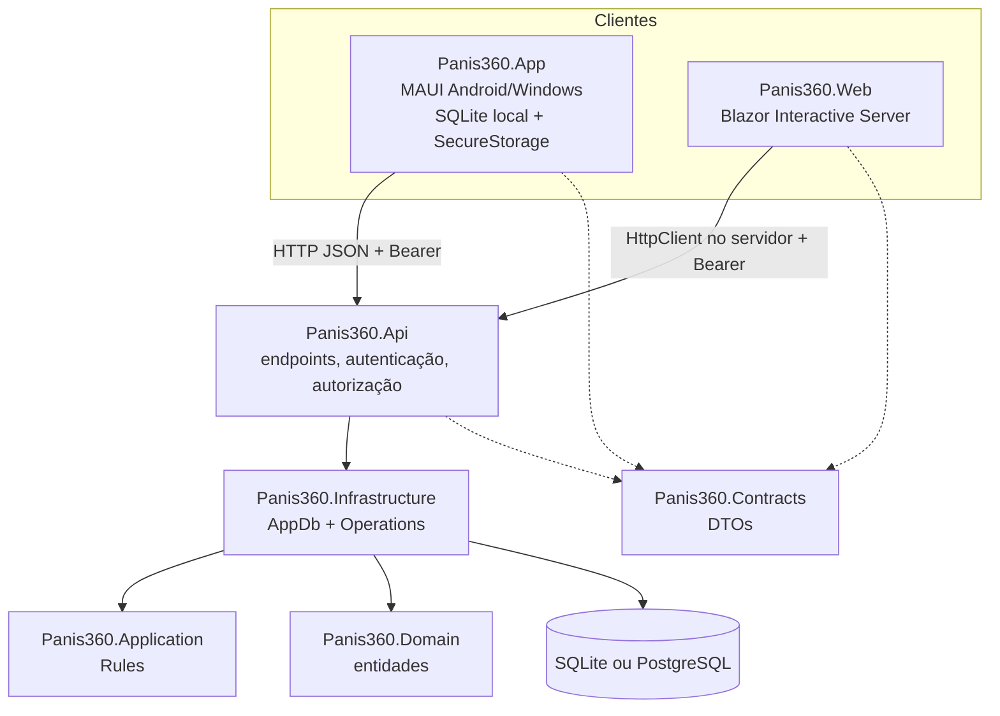
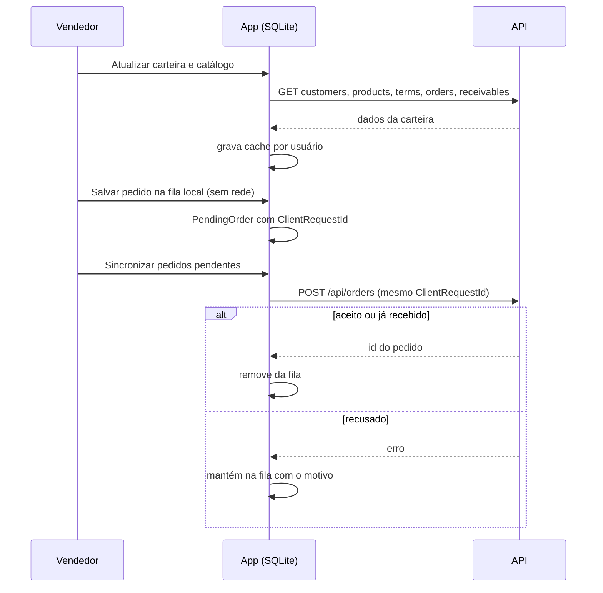

# 04 — Arquitetura

Monólito modular em .NET 10. O aplicativo e o painel consomem a mesma API, e **somente a API acessa o banco central**. A justificativa da decisão está no [ADR 001](adr/001-arquitetura.md).

## Projetos

| Projeto | Responsabilidade | Depende de |
| --- | --- | --- |
| `Panis360.Domain` | Entidades persistidas (`Entities.cs`) | — |
| `Panis360.Contracts` | DTOs de entrada e saída, com validação por DataAnnotations; sem Entity Framework | — |
| `Panis360.Application` | Regras puras: dinheiro, quantidades, parcelamento, listas de perfis e formas (`Rules.cs`) | Contracts |
| `Panis360.Infrastructure` | `AppDb` (DbContext), operações transacionais (`Operations.cs`), atualização de esquema (`SchemaUpgrade.cs`) | Application, Domain |
| `Panis360.Api` | Minimal API, autenticação por sessão, políticas por perfil, tratamento de erros, criação inicial | Infrastructure, Contracts |
| `Panis360.Web` | Painel administrativo; `ApiClient` guarda a sessão por circuito | Contracts |
| `Panis360.App` | App de vendas; `MobileApi`, `LocalStore` (SQLite), `MainPage` (UI em código) | Contracts |
| `Panis360.Tests` | Verificações executáveis com SQLite temporário; também gera o script PostgreSQL | Infrastructure |

`Panis360.App` fica fora de `Panis360.sln` para que o backend compile sem workloads móveis.

## Autenticação e autorização

- **Senhas:** `PasswordHasher<User>` do ASP.NET Core Identity, com no mínimo 12 caracteres.
- **Login:** `POST /auth/login` devolve um token aleatório de 256 bits. O banco guarda **apenas o hash SHA-256** do token. A sessão vale 12 horas.
- **Requisições:** cabeçalho `Authorization: Bearer TOKEN`, validado pelo `SessionAuth`, que também confere se o usuário está ativo.
- **Logout:** `POST /api/logout` apaga a sessão no servidor.
- **Limite de login:** 10 tentativas por minuto por IP (resposta 429).
- **Políticas:**

| Política | Perfis |
| --- | --- |
| `Admin` | Administrador |
| `Commercial` | Administrador, Vendedor |
| `Warehouse` | Administrador, Estoque |
| `Finance` | Administrador, Financeiro |

Além das políticas, os endpoints filtram por carteira: o vendedor só vê os próprios clientes, pedidos e títulos.

- **Sem senha fixa no código:** o administrador inicial vem de `Bootstrap:Email` e `Bootstrap:Password` (user-secrets ou variável de ambiente) e só é criado em banco sem usuários.

## Tratamento de erros

Um middleware converte as exceções em JSON `{"error": "mensagem"}`:

| Exceção | HTTP |
| --- | --- |
| `BusinessException` (regra de negócio) | 400 |
| `DbUpdateConcurrencyException` | 409, "Dados alterados por outro usuário…" |
| `DbUpdateException` (duplicidade, chave) | 409 |
| Qualquer outra | 500, com o detalhe apenas no log |

## Persistência

- **SQLite** é o padrão de demonstração (`panis360.db`), para rodar sem instalar servidor.
- **PostgreSQL** é o destino para operação real, escolhido por `Database:Provider`.
- Em Development, `EnsureCreated` cria o esquema em banco vazio, e `SchemaUpgrade` aplica as alterações incrementais idempotentes (hoje: a coluna `Movements.ActorId`). `EnsureCreated` **não** atualiza bancos existentes de outras formas.
- Fora de Development, o esquema precisa existir (`database/postgresql-inicial.sql`).
- Antes de uso real com dados, adotar **migrations do EF Core** e rotina de backup e restauração.
- As transações de venda e recebimento usam isolamento **Serializable**.

## Painel web

- Blazor com renderização interativa no servidor (SignalR). O navegador nunca recebe o token da API.
- A sessão vive na memória do circuito: recarregar a página por completo exige novo login.
- O componente `SessionGate` exibe o login e bloqueia telas por perfil. A API revalida as permissões em todas as chamadas.
- Fora de Development, ativa HTTPS, HSTS e uma página de erro.

## Aplicativo offline

- **Sessão** em `SecureStorage`; **endereço da API** em `Preferences` (padrão `http://127.0.0.1:5207`); tempo limite de 25 s.
- **Banco local** `panis360-local.db`, com as tabelas `CachedData` (cache JSON por chave `usuário:nome`) e `PendingOrder` (fila separada por usuário).
- A troca de usuário limpa a memória; o cache só é lido pelo mesmo usuário.
- O carrinho fica **só em memória** até tocar em *Salvar pedido na fila local*.
- A sincronização é **manual**. Cadastro de cliente e registro de visita exigem conexão.
- A base local **não** tem criptografia adicional; o aparelho precisa de bloqueio de tela.
- HTTP só é liberado no manifesto Android de Debug.

## Integração contínua

`.github/workflows/build.yml` roda a cada push e pull request, no Ubuntu com .NET 10.x: `restore` → `build` (Release) → `tests/Panis360.Tests`. O app MAUI não é compilado no CI.
