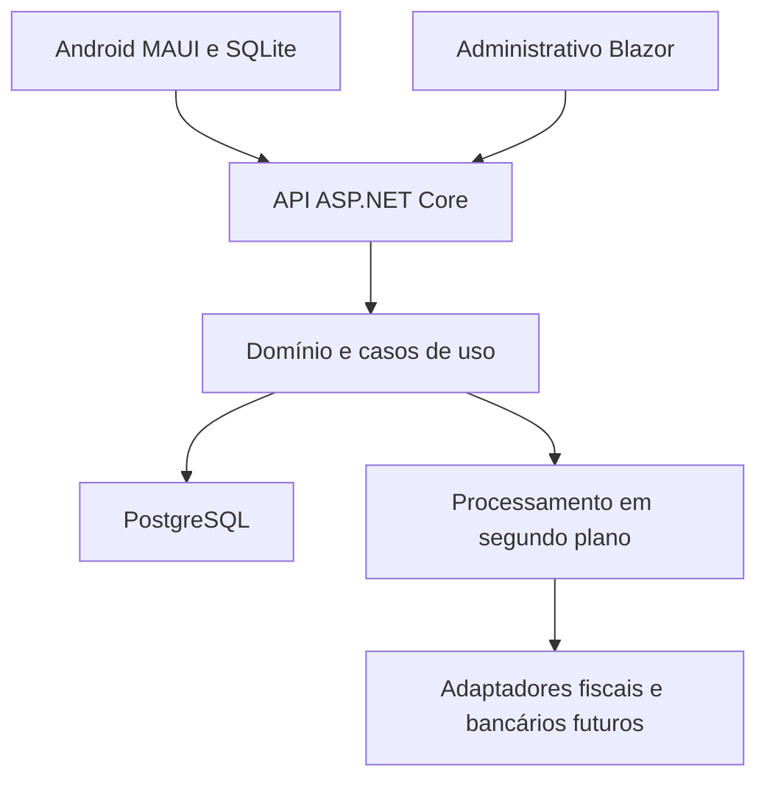

# 04 — Arquitetura e sincronização

Status: proposta técnica, detalhada no ADR 001.

## Organização prevista

| Projeto futuro | Responsabilidade | Dependências internas |
| --- | --- | --- |
| Panificacao.Domain | Entidades e invariantes | Nenhuma |
| Panificacao.Application | Casos de uso e interfaces | Domain |
| Panificacao.Contracts | DTOs e contratos públicos | Nenhuma dependência de infraestrutura |
| Panificacao.Infrastructure | EF Core, persistência e adaptadores | Application e Domain |
| Panificacao.Api | HTTP, composição e autorização | Application, Infrastructure e Contracts |
| Panificacao.Web | Administrativo Blazor | Contracts e cliente HTTP |
| Panificacao.App | Android, SQLite e fila local | Contracts e cliente HTTP |
| Panificacao.Tests | Testes por nível | Projetos conforme escopo |

Blazor com processamento no servidor é o ponto de partida proposto para o administrativo online. O web não deve acessar o banco por conta própria, contornando a API. Modelos EF e entidades internas não serão enviados diretamente aos clientes.

## Sincronização

1. Autenticação inicial online; carregar somente carteira autorizada e catálogo.
2. Gravar pedido e fila de envio na mesma transação SQLite.
3. Criar UUID do pedido no aparelho, preservado em todas as tentativas.
4. Enviar com chave de idempotência; API autentica, valida carteira e versão.
5. API grava pedido e resultado idempotente na mesma transação.
6. Aplicativo confirma recebimento apenas após resposta válida; timeout permite reenvio seguro.
7. Erros transitórios usam espera progressiva; erros de negócio exigem ação do usuário.
8. Atualizações descendentes usam cursor opaco, paginação e marcações de inativação.

Mesma chave + mesmo conteúdo retorna o mesmo resultado; mesma chave + conteúdo diferente retorna conflito. A restrição única no banco é a proteção final contra duas requisições simultâneas. A política de retenção da chave deve cobrir toda a vida de reenvio do pedido.

## Conflitos e acesso offline

- Preço/condição desatualizados: encaminhar para revisão comercial e apresentar diferença.
- Cliente transferido de carteira: rejeitar novo envio sem autorização; preservar a coleta local para resolução pelo supervisor.
- Cadastro central vence em campos cadastrais; aplicativo não sobrescreve alterações sem versão válida.
- Logout exige informar pendências locais; não apagar pedidos não sincronizados sem tratamento explícito.
- Credenciais revogadas impedem novos envios. Prazo de acesso offline será definido em D11; o servidor revalida toda operação.
- Resumo financeiro sempre exibe a data de atualização e pode estar desatualizado.

## Consistência e operação

Reservas e cortes usam transações e bloqueio/controle de concorrência por saldo elegível; não confiar em leitura seguida de gravação sem proteção. Integrações externas usam eventos persistidos (outbox), repetição segura e reconciliação. Não manter transação do banco aberta durante chamada ao provedor externo.

Segredos em armazenamento seguro do servidor e do dispositivo; dados locais sensíveis devem ter proteção compatível com o risco. Definir estratégia de criptografia local e perda de aparelho antes do piloto. Datas de negócio usam fuso configurado; instantes de auditoria usam UTC.

Versões de SDK, MAUI, Android, EF Core e provedor PostgreSQL serão verificadas e fixadas em E1. Não há comandos de compilação válidos antes da criação dos projetos.
