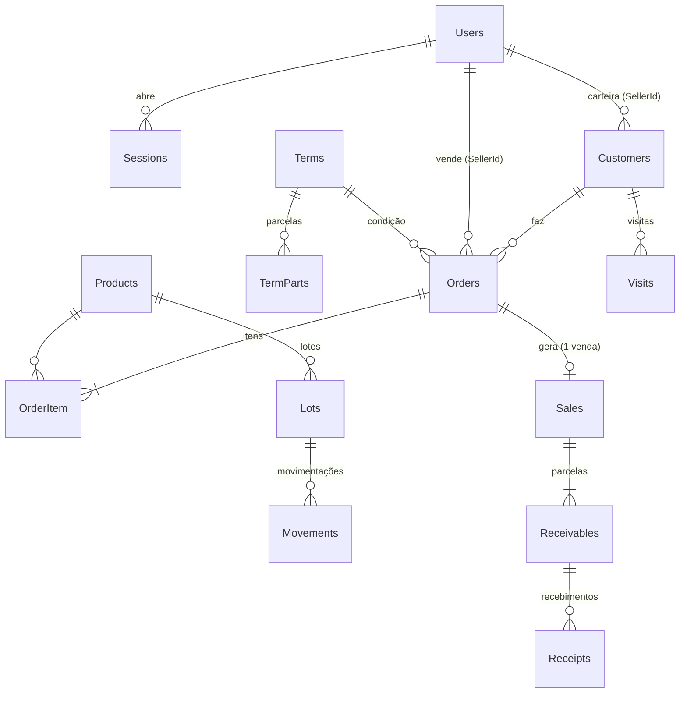

# 05 — Modelo de dados

Entidades em `src/Panis360.Domain/Entities.cs`, configuradas em `src/Panis360.Infrastructure/AppDb.cs`. Todos os identificadores são `Guid`. Instantes ficam em UTC; datas de negócio (validade, venda, vencimento) são `DateOnly`. Todo `decimal` tem precisão `(18,3)`.



## Tabelas

| Tabela (entidade) | Campos | Restrições |
| --- | --- | --- |
| `Users` (User) | Name, Email, PasswordHash, Role, Active | Email único |
| `Sessions` (Session) | TokenHash, UserId, ExpiresAt | TokenHash único; FK Users |
| `Customers` (Customer) | Name, Document, Phone, Street, Number, Neighborhood, City, State, ZipCode, SellerId, VisitOrder, Blocked | Document único; FK Users (vendedor) |
| `Products` (Product) | Name, Group, Unit, Price, Active | — |
| `Lots` (StockLot) | ProductId, Code, ExpiresOn, Quantity, Revision | (ProductId, Code) único; Revision é token de concorrência |
| `Movements` (StockMovement) | StockLotId, SaleId?, ActorId?, Quantity (positiva = entrada, negativa = saída), Date, Reason | FK Lots |
| `Terms` (PaymentTerm) | Name | — |
| `PaymentTermPart` | PaymentTermId, Days, Percent | FK Terms |
| `Orders` (Order) | ClientRequestId, RequestHash, CustomerId, SellerId, PaymentTermId, PaymentMethod, CreatedAt, Status, Revision, CutReason | ClientRequestId único; Revision é token de concorrência |
| `OrderItem` | OrderId, ProductId, ProductName, Requested, Accepted, UnitPrice | FK Orders, Products |
| `Sales` (Sale) | OrderId, CustomerId, Date, Total | OrderId único (uma venda por pedido) |
| `Receivables` (Receivable) | SaleId, CustomerId, Number, DueDate, Amount, Paid, Revision, PaymentMethod | Revision é token de concorrência; FK Sales |
| `Receipts` (Receipt) | ReceivableId, RequestId, Amount, Date | RequestId único |
| `Visits` (Visit) | CustomerId, SellerId, Date, Note | FK Customers |
| `Audits` (Audit) | ActorId, Date, Action, TargetId | — |

Todas as chaves estrangeiras usam `DeleteBehavior.Restrict`: registros com vínculos não são apagados em cascata.

## Valores derivados

- **Saldo da parcela** = `Amount − Paid` (não é armazenado).
- **Total do pedido** = soma de `Money(Accepted × UnitPrice)`.
- **Estoque válido do produto** = soma de `Quantity` dos lotes com `ExpiresOn ≥ hoje`.
- **Saldo após cada movimentação** = soma acumulada de `Movements.Quantity`, calculada na consulta do histórico.

## Scripts de banco

| Arquivo | Uso |
| --- | --- |
| `database/postgresql-inicial.sql` | Esquema PostgreSQL completo, gerado pelo modelo EF. Alternativa ao `EnsureCreated`, não um passo extra |
| `database/postgresql-002-usuario-movimentacao.sql` | Adiciona `Movements.ActorId` em bancos criados antes dessa coluna e preenche pela auditoria. Pode rodar mais de uma vez |

Para regenerar o esquema PostgreSQL depois de mudar o modelo:

```powershell
dotnet run --project tests/Panis360.Tests -- --schema database/postgresql-inicial.sql
```

Toda alteração de modelo precisa também de um caminho de atualização para bancos existentes: um script numerado em `database/` e/ou um passo idempotente em `SchemaUpgrade.cs`, até a adoção de migrations.
